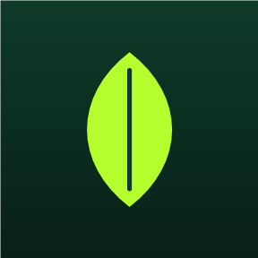
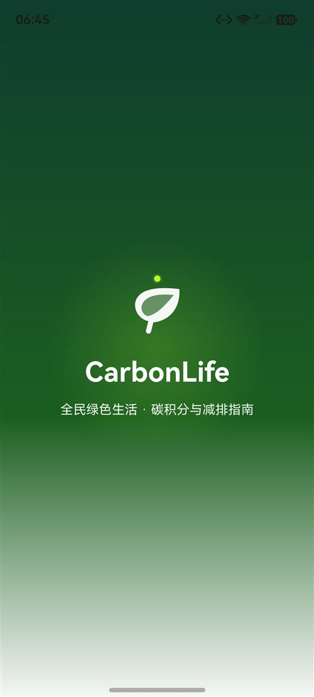
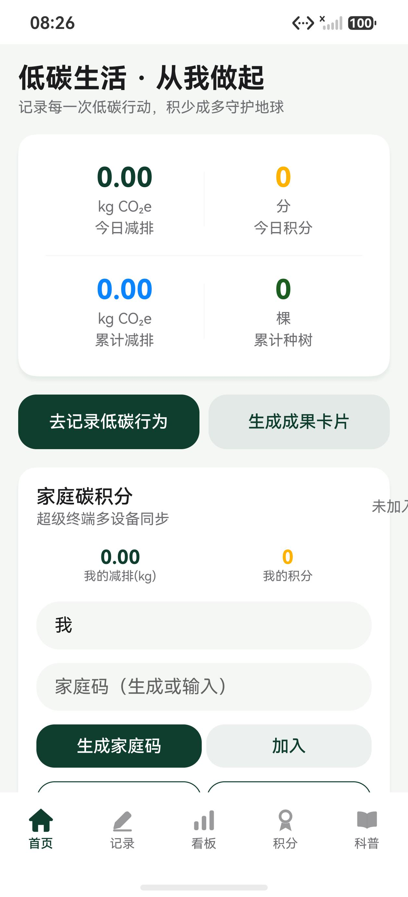
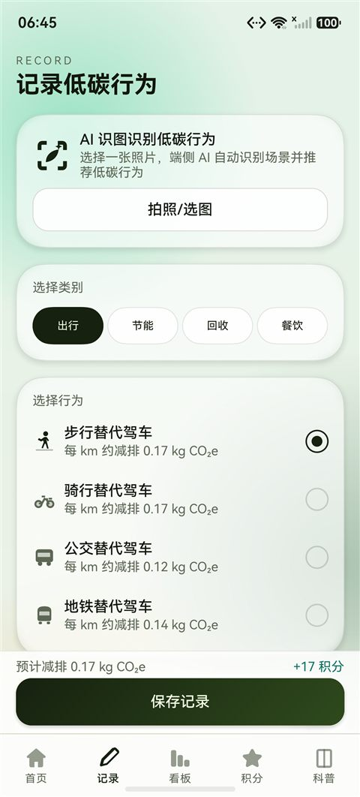
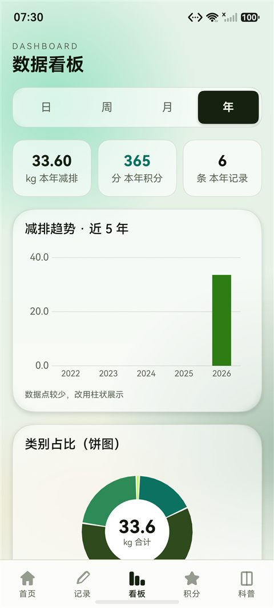
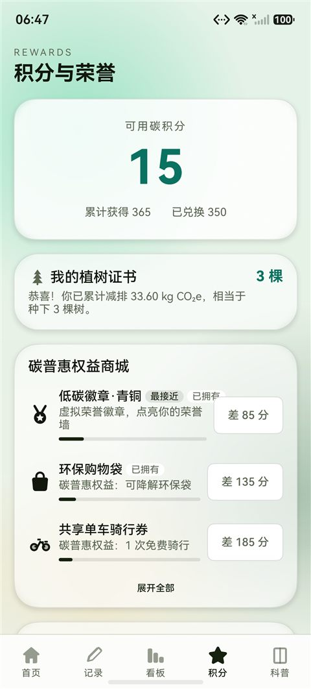
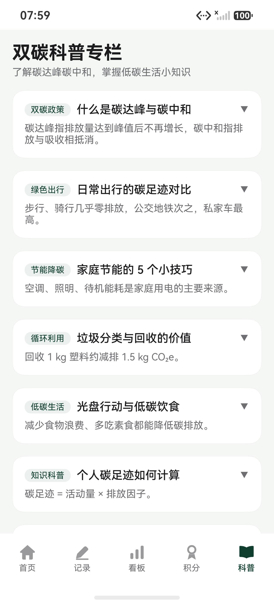

# CarbonLife · 碳足迹

<p align="center">
  
</p>

<p align="center">
  基于 <b>HarmonyOS / OpenHarmony</b> 的低碳生活记录与激励应用（ArkTS + ArkUI 声明式 UI）
</p>

<p align="center">
  
  
  
  
</p>

<p align="center">
  <a href="#功能特性">功能特性</a> •
  <a href="#截图">截图</a> •
  <a href="#技术栈">技术栈</a> •
  <a href="#项目结构">项目结构</a> •
  <a href="#设计系统">设计系统</a> •
  <a href="#快速开始">快速开始</a> •
  <a href="#路线图">路线图</a>
</p>

---

## 简介

**CarbonLife（碳足迹）** 是一款面向鸿蒙生态的低碳生活助手：记录步行、骑行、公交、节电、回收、光盘等日常低碳行为，按「活动量 × 排放因子」自动计算碳减排量并折算碳积分，通过积分兑换碳普惠权益，并可在超级终端场景下与家人共享家庭碳积分。

项目以「双碳」目标为背景，探索**端侧 AI、分布式数据、后台提醒、深浅主题**等鸿蒙原生能力在绿色生活场景中的落地，并配套一套可被 AI Agent 直接消费的设计规范（`DESIGN.md`）。

## 功能特性

- 📝 **低碳行为记录** — 出行 / 节能 / 回收 / 餐饮四大类共 **13 种**低碳行为，按排放因子自动计算减排量与积分（单条不低于 5 分，每日记录积分上限 300 分且在界面可见）
- 🤖 **端侧 AI 识图** — 基于 CoreVisionKit 端侧物体检测，选图后自动推荐对应低碳行为
- 📊 **数据看板** — 日/周/月/年趋势折线图、柱状图、类别占比饼图（**各图表与汇总卡片统一跟随所选周期**）；最近记录与 **CSV / JSON 导出**（含 RFC 4180 转义 + BOM）
- 🏅 **积分与荣誉** — 碳积分累计、碳普惠权益商城（模拟兑换码）、低碳徽章、植树证书、今日任务
- 👨‍👩‍👧 **家庭碳积分** — 基于分布式数据对象（DistributedDataObject），生成/加入家庭码，按设备聚合成员减排与积分
- ☁️ **本地 + 云备份** — 整包快照（记录 + 兑换 + 任务奖励）导出 / 去重合并恢复；AGC 云存储备份可开关，未开启时与纯本地应用一致
- ⏰ **每日提醒** — 基于后台代理提醒，默认每天 20:00 提醒记录
- 📚 **双碳科普专栏** — 碳达峰/碳中和、绿色出行、家庭节能等科普内容
- 🌗 **浅色 / 深色主题** — 全部色彩走动态设计 token，**跟随系统 `colorMode`**（冷启动读取系统配置，运行中实时切换）
- ✨ **动效语言** — 关键读数数字滚动、图表绘制入场（折线揭示 / 柱图生长 / 饼图扫入）、背景光斑呼吸、启动页光晕与环轨、Tab 淡入；曲率滑杆吸附、文字揭示、水波纹点击、曲线卡片删除等细节交互；少量品红「不和谐的秩序」活点
- 📱 **大屏适配** — 数据看板在平板上切换为多列布局，手机端保持单列信息流
- ♿ **无障碍** — 首页「减弱动效」开关，统一降级进入 / 图表 / 背景动效（`AppMotion` 读取 `reduceMotion`）

## 截图

| 启动页 | 首页 | 记录 |
|:---:|:---:|:---:|
|  |  |  |

| 数据看板 | 积分与荣誉 | 双碳科普 |
|:---:|:---:|:---:|
|  |  |  |

> 以上为 2026-10 最新 UI；答辩用的 PPT / PDF / 讲稿见 [`docs/tasks/ppt/`](docs/tasks/ppt/)。

## 技术栈

- **语言**：ArkTS　**UI**：ArkUI（声明式）
- **目标系统**：HarmonyOS / OpenHarmony（`compatibleSdkVersion` **26.0.0**，stage 模型）
- **核心 Kit**：
  - `@kit.ArkData` — Preferences 本地存储、DistributedDataObject 分布式对象
  - `@kit.CoreVisionKit` — 端侧物体检测
  - `@kit.BackgroundTasksKit` — 代理提醒
  - `@kit.MediaLibraryKit` / `@kit.ImageKit` — 图片选择与像素图
  - `@kit.CoreFileKit` — 文件导出
  - `@kit.AbilityKit` — Ability、权限申请、Configuration

## 项目结构

```
CarbonLife/
├── AppScope/                         # 应用级配置与图标
├── entry/src/main/
│   ├── ets/
│   │   ├── common/                   # Constants(AppColor/AppConst) · Theme(tokens/动效) · DateUtil · Localize
│   │   ├── components/               # AppCard · AppButton · Badge · TaskCard · AnimatedNumber · Chart(Canvas 图表)
│   │   ├── model/                    # CarbonStore · CarbonFactors · FamilyService · MallService · ReminderService · VisionService · CloudBackup · Rewards
│   │   ├── pages/                    # Splash · Index(5 Tab)
│   │   └── view/                     # HomeTab · RecordTab · DashboardTab · RewardsTab · KnowledgeTab
│   ├── resources/                    # 字符串/颜色/SVG 图标
│   └── module.json5                  # 模块与权限声明
├── scripts/run.ps1                   # 构建 + 安装 + 启动封装
├── scripts/ui-smoke.ps1              # 设备端 UI 冒烟测试（devecocli ui 驱动，逐页断言）
├── scripts/build-signed.ps1          # 签名构建（真机 / 云备份端到端验证用）
├── ppt_tasks/carbonlife-defense/     # 答辩 PPT 构建工程（脚本 + 素材 + 设计锁）
├── docs/tasks/ppt/                   # 答辩 PPT / PDF / 讲稿要点
├── DESIGN.md                         # 设计系统（YAML tokens + 9 章节）
├── AGENTS.md                         # 面向 AI Agent 的仓库上下文
└── build-profile.json5
```

## 设计系统

`DESIGN.md` 是一份符合 [Google Stitch DESIGN.md 规范](https://stitch.withgoogle.com/docs/design-md/overview/) 的设计说明书：**YAML design tokens（机器可读）+ 9 个章节（人类可读）**。

- 所有 token 与 `common/Theme.ets` 一一对应；改 UI 前请先读它，颜色/字号/间距/圆角一律引用 `AppColor.*` / `AppTypography.*` / `AppSpacing.*` / `AppRadius.*`，禁止硬编码。
- 用官方 lint 校验（应 0 error）：

```bash
npx -y -p @google/design.md designmd lint DESIGN.md
```

> `DESIGN_SYSTEM.md` 为早期版本，已归档，仅作历史参考。

## 快速开始

### 环境要求
- DevEco Studio（含 HarmonyOS SDK，API/`compatibleSdkVersion` 26.0.0）
- Node.js（Hvigor 构建）

### 构建与运行
1. 用 DevEco Studio 打开项目根目录，等待 Hvigor 同步。
2. 连接鸿蒙真机 / 启动模拟器，点击 **Run**（或使用下方的命令行脚本）。

命令行（Windows）：
```powershell
# 构建 + 安装 + 启动（无签名配置时安装 unsigned HAP，模拟器可用）
powershell -ExecutionPolicy Bypass -File scripts\run.ps1 -AllowUnsigned

# 仅构建
powershell -ExecutionPolicy Bypass -File scripts\run.ps1 -BuildOnly
```

### 签名
`build-profile.json5` 默认未配置签名。真机调试/发布时，请在 DevEco Studio 中开启 **File > Project Structure > Signing Configs > Automatically generate signature**（需登录华为账号），或手动填入 `signingConfigs`。

## 权限说明

| 权限 | 类型 | 用途 |
|---|---|---|
| `ohos.permission.INTERNET` | system_grant | AGC 云存储备份 / 恢复 |
| `ohos.permission.DISTRIBUTED_DATASYNC` | user_grant（运行时申请） | 家庭碳积分多设备同步 |
| `ohos.permission.PUBLISH_AGENT_REMINDER` | system_grant | 每日定时提醒 |

## 数据与隐私

- 所有记录仅保存在**本机**（Preferences），不上传云端。
- 家庭碳积分通过分布式数据对象在**同一账号的设备间**同步，数据不经过第三方服务器。
- 端侧 AI 识图在本机完成（CoreVisionKit），不上传图片。

## 测试与多 Agent 协作

本项目按「写审分离」组织协作，仓库内置：
- `AGENTS.md` — 仓库上下文（构建 / 部署 / 约定），任何 Agent 进入即可读
- `docs/TEAM_TESTING.md` — **组内模拟器测试指南**（环境要求、三种运行方式、冒烟/单元测试、回归清单、反馈模板）
- `.claude/agents/device-qa.md` / `.opencode/agent/device-qa.md` — 设备验证 Agent（只读）：在模拟器上构建、安装、截图、驱动 UI 并逐条核对验收清单
- `HANDOFF.md` — 交接简报模板（变更清单 + 验收清单 + 命令）

## 路线图

- [x] 支持自定义每日提醒时间；任务完成后自动发放额外积分
- [x] CSV / JSON 数据**导入**，以及本地整包备份 / 恢复（记录 + 兑换 + 任务奖励）
- [x] 数据**云备份**：接入 AGC 云存储的整包快照（可开关）；本地备份/恢复始终可用（已补 `ohos.permission.INTERNET` 与失败态区分；端到端待签名构建）
- [x] **数据健壮性**：导入（JSON / CSV / 整包快照）逐字段校验与归一化（丢弃坏记录、单条积分封顶、时间戳归一）；导出文件补 `TRUNC` 截断
- [x] 补充 UI 测试（**设备端冒烟**：`scripts/ui-smoke.ps1`，用 `devecocli ui` 驱动，**手机 + 平板各 20/20 通过**；**单元测试**：DateUtil / 排放因子 / 快照结构 / 导入校验，基于 `@ohos/hypium`）
- [x] 一轮完整的 UI 设计评审与动效升级（首页信息架构、粘性保存、商城可达性、看板口径一致、列表折叠等）
- [ ] 云备份**冲突合并策略**，并完成签名构建下的端到端验证
- [ ] 对接真实城市碳普惠平台 API，替代本地模拟兑换码
- [ ] 家庭碳积分改用分布式 KV（见 `docs/ROADMAP.md` #2），实现跨设备多成员并集
- [ ] 平板其余页面补齐多列布局（数据看板已完成，宽屏断点已改响应式）
- [ ] 接入系统无障碍设置，真正启用「减弱动效」（App 内开关已就绪）

## 贡献

1. Fork 本仓库
2. 新建分支：`git checkout -b feature/your-feature`
3. 提交：`git commit -am 'feat: ...'`
4. 推送并发起 Pull Request

请保持代码风格一致，改动 UI 前先阅读 `DESIGN.md`，并确保 `assembleHap` 通过。

## 许可证

本项目基于 [MIT License](LICENSE) 开源。

---

<p align="center">记录每一次低碳行动，积少成多守护地球 🌍</p>
